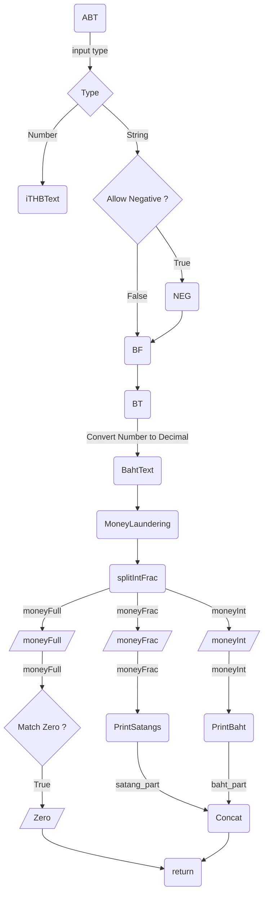

# BahtRext

[](https://www.npmjs.com/package/bahtrext)
[](https://www.npmjs.com/package/bahtrext)
[](https://sonarcloud.io/summary/new_code?id=PingHuskar_npm-bahtrext)
[](https://opensource.org/licenses/MIT)

BahtRext is a JavaScript library that converts monetary amounts to Thai Baht text and converts Thai Baht text back to numbers.

```js
BT("1234.50");
// => "หนึ่งพันสองร้อยสามสิบสี่บาทห้าสิบสตางค์"

TB("สองบาทห้าสิบสตางค์");
// => "2.50"
```

**[Website](https://pinghuskar.gitlab.io/npm-bahtrext/)** · **[npm](https://www.npmjs.com/package/bahtrext)** · **[Source](https://gitlab.com/PingHuskar/npm-bahtrext)**

## Contents

- [Features](#features)
- [Installation](#installation)
- [Quick start](#quick-start)
- [Reading of a trailing one](#reading-of-a-trailing-one)
- [Choosing a conversion function](#choosing-a-conversion-function)
- [API reference](#api-reference)
- [SQL Server functions](#sql-server-functions)
- [Architecture](#architecture)
- [Development](#development)
- [Changelog](#changelog)
- [Support the project](#support-the-project)
- [Author and license](#author-and-license)

## Features

- **Arbitrary precision:** amounts are processed as strings, so very large values keep every digit.
- **Two-way conversion:** convert numbers to Baht text with `BT`, and Baht text to numbers with `TB`.
- **Flexible input:** accepts comma and underscore separators, Thai numerals, BigInt-style literals, and binary, octal and hexadecimal literals.
- **Configurable output:** choose how a trailing one is read, and round extra decimal places up or down.
- **Negative amounts:** read a leading minus sign as `ลบ`.
- **Scale and sorting helpers:** shorten very large numbers and sort Thai number text by value.
- **Synchronous API:** every function returns its result directly.

## Installation

```sh
npm install bahtrext
```

Version 2 is distributed as ES modules that use extensionless and directory imports, so it must be loaded through a bundler or a compatible toolchain such as esbuild or Jest. Importing it directly with Node.js fails with `ERR_UNSUPPORTED_DIR_IMPORT`.

Projects that need the earlier ES5 release can install it explicitly:

```sh
npm install bahtrext@1.7.2
```

### Browser bundle

Build a single browser-ready file from a clone of the repository:

```sh
npm run bundle
```

This uses [esbuild](https://esbuild.github.io/) to write `out.js`, an IIFE that exposes every export on a global `BahtRext` object. The default export, the `BR` class, is available as `BahtRext.default`. The file is a build artifact and is not committed or published to npm.

```html
<script src="out.js"></script>
<script>
  BahtRext.B2("101");
  // => "หนึ่งร้อยหนึ่งบาทถ้วน"

  new BahtRext.default("1234.5").text;
  // => "หนึ่งพันสองร้อยสามสิบสี่บาทห้าสิบสตางค์"
</script>
```

## Quick start

```js
import BR, { BT, TB, NEG, SortNumText } from "bahtrext";

BT("1,234,567.25");
// => "หนึ่งล้านสองแสนสามหมื่นสี่พันห้าร้อยหกสิบเจ็ดบาทยี่สิบห้าสตางค์"

TB("หนึ่งร้อยหนึ่งบาทถ้วน");
// => "101.00"

NEG("-1234.50");
// => "ลบหนึ่งพันสองร้อยสามสิบสี่บาทห้าสิบสตางค์"

SortNumText(["สอง", "หก", "หนึ่ง"]);
// => ["หนึ่ง", "สอง", "หก"]

new BR("1234.5").currency;
// => "฿1,234.50"
```

## Reading of a trailing one

Thai software differs on how to read `101`. Both forms below are in common use, so BahtRext supports both and defaults to the first.

| Reading | Used by |
| --- | --- |
| `หนึ่งร้อยหนึ่งบาทถ้วน` | BahtRext (default), [Google Sheets](https://sheets.google.com/), [bahttext](https://www.npmjs.com/package/bahttext) |
| `หนึ่งร้อยเอ็ดบาทถ้วน` | BahtRext (`ed` enabled), [Microsoft Excel](https://www.microsoft.com/th-th/microsoft-365/excel), [thai-baht-text](https://www.npmjs.com/package/thai-baht-text), [BAHTTEXT.js](https://gitlab.com/earthchie/BAHTTEXT.js) |

In both readings, a one that follows a non-zero tens digit is always `เอ็ด`, as in `สิบเอ็ด` and `ยี่สิบเอ็ด`.

```js
BT("101");
// => "หนึ่งร้อยหนึ่งบาทถ้วน"

BT("101", true);
// => "หนึ่งร้อยเอ็ดบาทถ้วน"
```

## Choosing a conversion function

| Function | Accepts | Negative input | Thai numerals | Invalid input returns |
| --- | --- | --- | --- | --- |
| `BT` | string | No | No | `undefined` |
| `B2` | string | No | No | `""` |
| `BF` | string | No | Yes | `""` |
| `NEG` | string | Yes | Yes | `""` |
| `ABT` | string, number or BigInt | Numbers always; strings with `allowNeg` | Yes (strings) | `""` (strings), `undefined` (other types) |

Use `BT` or `B2` for amounts already held as numeric strings. Use `BF` for text that may contain Thai numerals, `NEG` when amounts can be negative, and `ABT` when the input type varies.

## API reference

The tables list parameters as the code currently behaves. Optional parameters are shown with their defaults.

### Number to text

#### `BT(money, ed = false, OL = false, rounding = "")`

Converts an amount to Baht text.

| Parameter | Type | Description |
| --- | --- | --- |
| `money` | `string` | The amount. Commas, underscores and whitespace are ignored. |
| `ed` | `boolean` | Reads a trailing one as `เอ็ด`. See [Reading of a trailing one](#reading-of-a-trailing-one). |
| `OL` | `boolean` | Treats octal literals such as `077` and `0o77` as octal. Binary (`0b`) and hexadecimal (`0x`) literals are always converted. |
| `rounding` | `"" \| "c" \| "f"` | Handling of non-zero digits after the second decimal place: `""` treats them as invalid, `"c"` rounds up and `"f"` rounds down. |

```js
BT("4.990001", false, false, "c");
// => "ห้าบาทถ้วน"

BT("4.990001", false, false, "f");
// => "สี่บาทเก้าสิบเก้าสตางค์"

BT("0x10");
// => "สิบหกบาทถ้วน"

BT("0o77", false, true);
// => "หกสิบสามบาทถ้วน"
```

#### `B2(money, config = {})`

Same conversion as `BT`, with options passed as an object: `{ ed, OL, rounding }`. Returns `""` rather than `undefined` for invalid input.

```js
B2("101", { ed: true });
// => "หนึ่งร้อยเอ็ดบาทถ้วน"
```

#### `BF(money, options?)`

Converts Thai numerals to Arabic numerals, then calls `B2`. Accepts `{ ed, OL }`. Returns `undefined` for empty input and the `InvalidTypeError` class for non-string input.

```js
BF("๑๒๓.๕๐");
// => "หนึ่งร้อยยี่สิบสามบาทห้าสิบสตางค์"
```

#### `NEG(money, ed = false)`

Reads a single leading minus sign as `ลบ`, then calls `BF`. Zero is not read as negative. Note that `ed` is a boolean rather than an options object.

```js
NEG("-101", true);
// => "ลบหนึ่งร้อยเอ็ดบาทถ้วน"

NEG("-0");
// => "ศูนย์บาทถ้วน"
```

#### `ABT(money, config = {})`

Selects a conversion from the input type. Accepts `{ ed, allowNeg }`, both `false` by default.

Numbers and BigInts are converted by [thai-baht-text](https://www.npmjs.com/package/thai-baht-text), which always reads a trailing one as `เอ็ด` and ignores `ed`. This means `ABT(101)` and `ABT("101")` return different text.

```js
ABT(101);
// => "หนึ่งร้อยเอ็ดบาทถ้วน"

ABT("101");
// => "หนึ่งร้อยหนึ่งบาทถ้วน"

ABT("-101", { allowNeg: true });
// => "ลบหนึ่งร้อยหนึ่งบาทถ้วน"
```

#### `BahtText(money, ed = false, rounding = "", currencyformat = THB, ClErr = MoneyInvalid, arrow = "อ่านว่า")`

Lower-level function that returns the formatted amount together with its reading. Most applications should use `BT` or `B2`.

```js
BahtText("1234.5");
// => "฿1,234.50 อ่านว่า \"หนึ่งพันสองร้อยสามสิบสี่บาทห้าสิบสตางค์\""
```

#### `BulkBahtText(text, options = {})`

Replaces each number found in a string with its Baht text. Accepts `{ pat, ed }`, where `pat` is a regular expression that selects the numbers to replace. Returns the `InvalidTypeError` class for non-string input.

```js
BulkBahtText("ราคา 100 บาท");
// => "ราคา หนึ่งร้อยบาทถ้วน บาท"

BulkBahtText("ราคา 101", { ed: true });
// => "ราคา หนึ่งร้อยเอ็ดบาทถ้วน"
```

#### `SEP(money, separator = "-")`

Returns the reading split into its parts. Input is read with `เอ็ด` enabled.

```js
SEP("1234.50");
// => "หนึ่ง-พัน-สอง-ร้อย-สาม-สิบ-สี่-บาท-ห้า-สิบ-สตางค์"
```

#### `LNBT(nameOrPower, multiplier = 1)`

Reads a power of ten, given as an exponent or as a name from `large_numbers`.

```js
LNBT(6, 3);
// => "สามล้านบาทถ้วน"

LNBT("Trillion");
// => "หนึ่งล้านล้านบาทถ้วน"
```

#### `OB(money)`

Returns the input with its type, conversion result and an error flag. The flag is `true` only when `ABT` returns `undefined`, which applies to unsupported input types. Invalid strings return `err: false` and `txt: ""`.

```js
OB("101");
// => {"val":"101","typ":"string","err":false,"txt":"หนึ่งร้อยหนึ่งบาทถ้วน"}
```

### Text to number

#### `TB(text, error = InvalidStringError)`

Converts Baht text to a numeric string with two decimal places. Both readings of a trailing one are accepted. Returns `error` when the text can't be converted, which by default is the `InvalidStringError` class rather than a thrown exception.

```js
TB("หกสิบเจ็ดสตางค์");
// => "0.67"

TB("หนึ่งร้อยเอ็ดบาทถ้วน");
// => "101.00"

TB("abc", "invalid");
// => "invalid"
```

#### `SatangNum(word)`

Converts a satang word to a two-digit string. Returns `undefined` for unrecognized words.

```js
SatangNum("ยี่สิบเอ็ด");
// => "21"

SatangNum("ถ้วน");
// => "00"
```

### Large number helpers

#### `MillionScaleText(num, config?)`

Reads only the leading group of digits, followed by the matching number of `ล้าน`. Lower-order digits are dropped. Accepts `{ ed, OL, rounding }`.

```js
MillionScaleText("5,566,857,732,147,160,000,000");
// => "ห้าพันห้าร้อยหกสิบหกล้านล้านล้าน"
```

#### `CompactScaleText(num, config?)`

Summarizes a large number as a three-decimal mantissa and a count of `ล้าน`. Values of six digits or fewer are read normally. Accepts `{ ed, OL, rounding }`.

```js
CompactScaleText("1234567890123");
// => "1.234 ตามด้วยคำว่า \"ล้าน\" 2 ครั้ง"
```

### Sorting

#### `SortNumText(arr, options = {})`

Sorts Thai number text by numeric value without losing precision. Accepts plain number words (`สอง`) and Baht text (`สองบาท`, `สองบาทถ้วน`, `สองบาทห้าสิบสตางค์`).

| Option | Type | Default | Description |
| --- | --- | --- | --- |
| `desc` | `boolean` | `false` | Sorts from largest to smallest. |
| `removeInvalid` | `boolean` | `false` | Removes invalid entries. When `false`, they are kept at the end in their original order. |

```js
SortNumText(["สอง", "หก", "หนึ่ง"], { desc: true });
// => ["หก", "สอง", "หนึ่ง"]

SortNumText(["สอง", "abc", "หก"]);
// => ["สอง", "หก", "abc"]

SortNumText(["สอง", "abc", "หก"], { removeInvalid: true });
// => ["สอง", "หก"]
```

Only canonical text is valid. For example, `หนึ่งร้อยหนึ่ง` is accepted, while `หนึ่งร้อยเอ็ด` and `สิบห้าร้อย` are treated as invalid.

### Validation

| Function | Returns `true` when |
| --- | --- |
| `IsMoneyValidate(money, rounding = "")` | The value is a valid amount. With the default rounding, amounts with more than two significant decimal places are invalid. |
| `IsValidText(text)` | The text is well-formed Thai number text. |
| `IsValidTB(text)` | The Baht text matches the library's canonical reading of its own value. |
| `ISINFSTR(value)` | The value equals `String(Number.MAX_VALUE)`, which `BT` reads as `อนันต์`. |

```js
IsMoneyValidate("1234.50");
// => true

IsValidText("สองสิบ");
// => false

IsValidTB("หนึ่งร้อยเอ็ดบาท");
// => false
```

### Building blocks

| Export | Description |
| --- | --- |
| `MoneyLaundering(money)` | Removes commas, underscores, whitespace and leading zeros. |
| `removeLeadingZeros(value)` | Removes leading zeros. |
| `PrintBaht(integer, ed = false)` | Reads the integer part, ending in `บาท`. |
| `PrintSatangs(fraction, rounding = "")` | Reads the fractional part. Returns `{ word, carry }`, where `carry` is `"1"` when rounding reaches a whole baht. |
| `PrintDotMRR(digits)` | Reads up to four digits after a decimal point, such as `5250` as `จุดห้าสองห้า`. |
| `NumText(text)` | Replaces each Arabic digit with its Thai word. |
| `LeadingSpecialOneToOne(text)` | Replaces a leading `เอ็ด` with `หนึ่ง`. |
| `repeat(text, counts)` | Repeats text once per entry in the `counts` array. For example, `repeat("0", [3])` returns `"000"`. |

### Constants

| Export | Description |
| --- | --- |
| `VERSION` | The library version. |
| `THAI2ARABICNumerals` | Thai and Arabic numeral pairs, as `{ th, a }` objects. |
| `large_numbers` | Named powers of ten, as `{ name, powof10 }` objects. |

### `BR` class

`BR` is the default export. It wraps a value and exposes the conversions as properties.

```js
import BR from "bahtrext";

new BR("100").sum("50").minus("25").text;
// => "หนึ่งร้อยยี่สิบห้าบาทถ้วน"

new BR("2").pow("10").currency;
// => "฿1,024.00"

new BR().set("หนึ่งร้อยบาท").text;
// => "หนึ่งร้อยบาทถ้วน"
```

| Member | Description |
| --- | --- |
| `set(value)` | Sets the value from an amount or Baht text. Chainable. |
| `sum(n)`, `minus(n)`, `pow(n)` | Arbitrary-precision arithmetic on the value. Chainable. |
| `toggleed()` | Switches the `ed` reading on or off for later conversions. Chainable. |
| `text`, `auto`, `flex`, `neg`, `sep`, `bahttext` | The results of `B2`, `ABT`, `BF`, `NEG`, `SEP` and `BahtText`. |
| `num` | The numeric string from `TB`. |
| `clean`, `trim` | The value after `MoneyLaundering` or `removeLeadingZeros`. |
| `currency` | The value formatted as Thai Baht currency. |
| `printBaht`, `printSatang` | The baht or satang part of the reading. |
| `isValid`, `isInfinity` | The results of `IsMoneyValidate` and `ISINFSTR`. |
| `log`, `version` | The values set so far, and the library version. |

## SQL Server functions

The `sql/` directory contains a T-SQL port of the core conversions as inline table-valued functions, for SQL Server 2017 and later.

Run the scripts from inside the directory, because `run_all.sql` includes them by relative path:

```sh
cd sql
sqlcmd -S <server> -d <database> -f 65001 -i run_all.sql -b
```

Each script creates its function, then runs build-time tests using [Redgate's approach](https://www.red-gate.com/hub/product-learning/sql-prompt/test-sql-server-functions-procedures-using-sql-prompt/). A `VALUES` table of inputs and expected outputs is joined to the function with `OUTER APPLY`, and any mismatch raises an error. Test cases are derived from `index.test.js`, `compare.test.js` and `base/*.test.js`.

| Script | Function | Ported from |
| --- | --- | --- |
| `00_Tally.sql` | `dbo.Tally(@Count)` | Helper |
| `01_TrimLeadingZeros.sql` | `dbo.TrimLeadingZeros(@TheInput)` | `removeLeadingZeros`, `BR.trim` |
| `02_ThaiNumberText.sql` | `dbo.ThaiNumberText(@TheInput, @Ed)` (0–999999) | Digit reading used by `BT` |
| `03_PrintSatangs.sql` | `dbo.PrintSatangs(@Satangs, @Rounding)` | `PrintSatangs` |
| `04_SatangNum.sql` | `dbo.SatangNum(@Word)` | `SatangNum` |
| `05_BahtText.sql` | `dbo.BahtText(@Money, @Ed, @Rounding)` | `BT`, `B2` |
| `06_NegBahtText.sql` | `dbo.NegBahtText(@Money, @Ed)` | `NEG` |
| `07_Base_Binary.sql` | `dbo.IsBinary`, `dbo.BinaryToDecimal` | `base/binary.js` |
| `08_Base_Octal.sql` | `dbo.IsOctal`, `dbo.OctalToDecimal` | `base/octal.js` |
| `09_Base_Hexadecimal.sql` | `dbo.IsHexadecimal`, `dbo.HexadecimalToDecimal` | `base/hexadecimal.js` |

The port differs from the JavaScript library in these ways:

- **Invalid input** returns `NULL`.
- **Literals:** `BahtText` doesn't convert binary, octal or hexadecimal literals. Convert them first with the `*ToDecimal` functions, which return `NULL` above 126 binary, 41 octal or 31 hexadecimal digits.
- **Whitespace:** `BahtText` removes spaces, tabs, line breaks and non-breaking spaces. Input containing other Unicode whitespace returns `NULL`.
- **Length:** the `*ToDecimal` functions have a fixed digit limit, while the JavaScript functions accept any length.

These aren't ported: `TB`, `IsValidText`, `IsValidTB`, `BulkBahtText`, `SEP`, `OB`, `LNBT`, `SortNumText`, `MillionScaleText`, `CompactScaleText`, `PrintDotMRR`, the `BR` class and the type checks.

## Architecture

The diagram shows how `ABT` routes an amount through the conversion pipeline.



## Development

Issues and merge requests are welcome on [GitLab](https://gitlab.com/PingHuskar/npm-bahtrext). New test cases are especially useful, and `index.test.js` is the best place to see expected behavior.

```sh
npm install
```

```sh
npm test
```

```sh
npm run testcv
```

```sh
npm run bundle
```

These install dependencies, run the tests, run the tests with coverage, and build `out.js`.

### OpenTelemetry

The repository includes `tracer.js`, an optional OpenTelemetry setup for local tracing. It isn't imported by the library or published to npm, and its `@opentelemetry/*` packages aren't listed in `package.json`, so install them before using it. Configure the exporter with these environment variables:

- `OTEL_EXPORTER_OTLP_ENDPOINT`
- `OTEL_EXPORTER_OTLP_HEADERS`

## Changelog

| Version | Changes |
| --- | --- |
| 2.5.7 | Fixed `TB` dropping digits after `หมื่น` and after a lone `เอ็ด`. Fixed decimal rounding in `PrintSatangs`, trailing zeros after the second decimal place, and non-numeric input being accepted when rounding. Fixed `NEG` for invalid input and zero. Made `BR.toggleed` and the `ed` option of `BulkBahtText` take effect. Accepted uppercase `0O` in `toDecOctal`. Aligned `index.d.ts` with the runtime API. |
| 2.5.6 | Added `SortNumText`, with `desc` and `removeInvalid` options. |
| 2.5.5 | Updated Thai numeral exports to Unicode representations, enhanced internal auto-correction, and improved parameter handling and regex patterns. |
| 2.5.4 | Added `CompactScaleText`. |
| 2.5.3 | Added `MillionScaleText`. |
| 2.3.4 | Added Infinity handling. |
| 2.2.0 | Moved to ES6 modules. The last ES5 release is 1.7.2. |
| 1.7.1 | Applied rest parameters and added `BulkReplace` and `applyReplacements`. |
| 1.7.0 | Added the `BR` class. |
| 1.6.2 | Refactored the codebase. |
| 1.6.1 | Allowed the comma as a literal separator. |
| 1.6.0 | Added hexadecimal literals. |
| 1.5.0 | Added binary literals. |
| 1.4.3–1.4.4 | Refactored the codebase. |
| 1.4.2 | Added `NEG`. |
| 1.3.3 | Updated the Thai Baht Text JS dependency and added `SEP`. |
| 1.2.1 | Added the Google Sheets cell character limit warning. |
| 1.2.0 | Added the configurable `เอ็ด` reading. |
| 1.1.7 | Removed `Googolplex`. |
| 1.1.3 | Added `LNBT`. |
| 1.1.1 | Fixed `TB` validation, made `BF` the main function, and added `ABT` for dynamic input types. |
| 1.1.0 | Prepared `TB` for production use. |
| 1.0.9 | Added `TB`, the reverse of `BT`. |
| 1.0.8 | Added `SatangNum`. |
| 1.0.6 | Made `BT` the main function. |

## Support the project

- Star the repository on [GitLab](https://gitlab.com/PingHuskar/npm-bahtrext)
- Sponsor through [GitLab Sponsors](https://gitlab.com/sponsors/PingHuskar)
- Review BahtRext on [Product Hunt](https://www.producthunt.com/products/bahtrext)
- Buy the [LINE sticker set](https://store.line.me/stickershop/product/28717665/en)

## Author and license

Created by [Chadin Chaipornpisuth](https://chadindev.in.th/). Released under the [MIT License](https://opensource.org/licenses/MIT).
